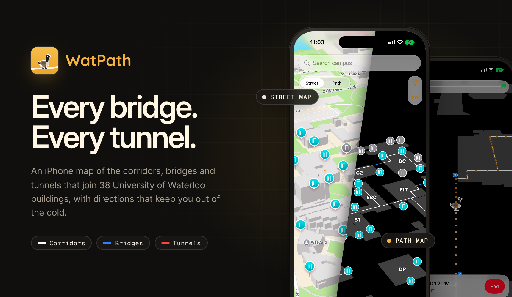
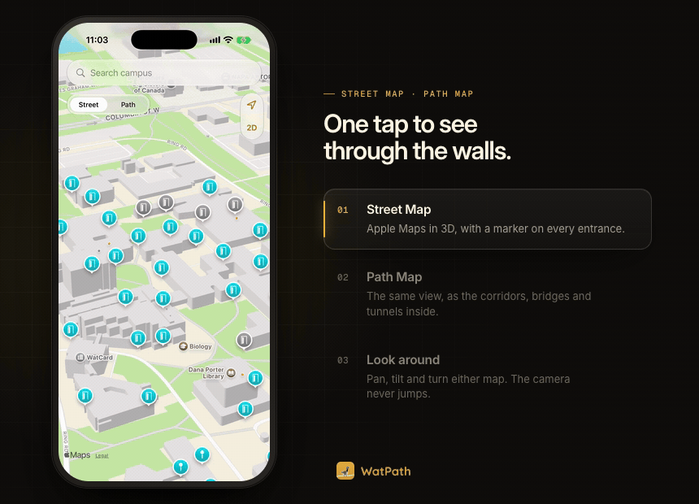
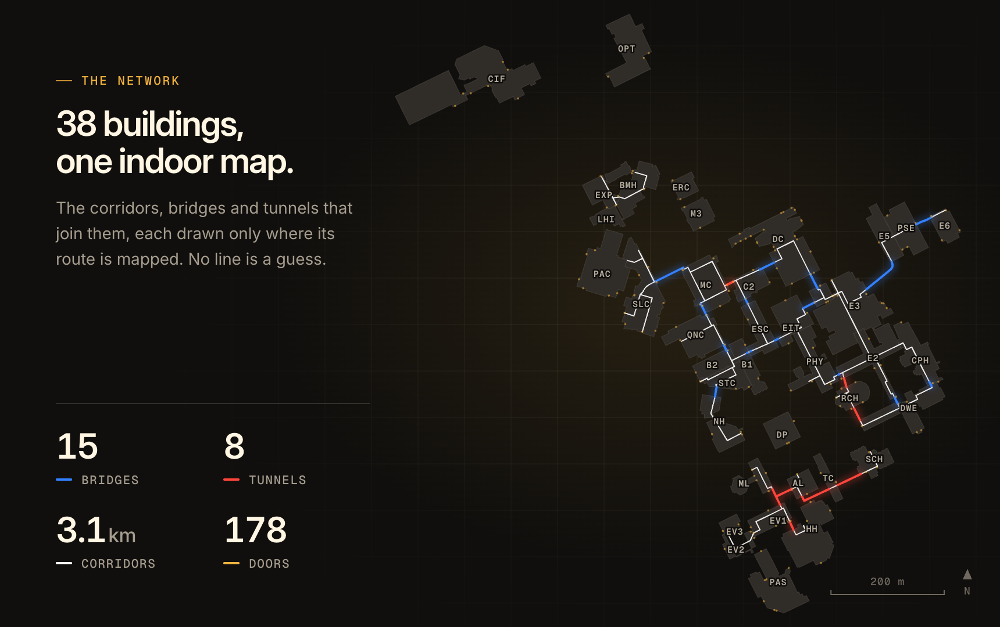
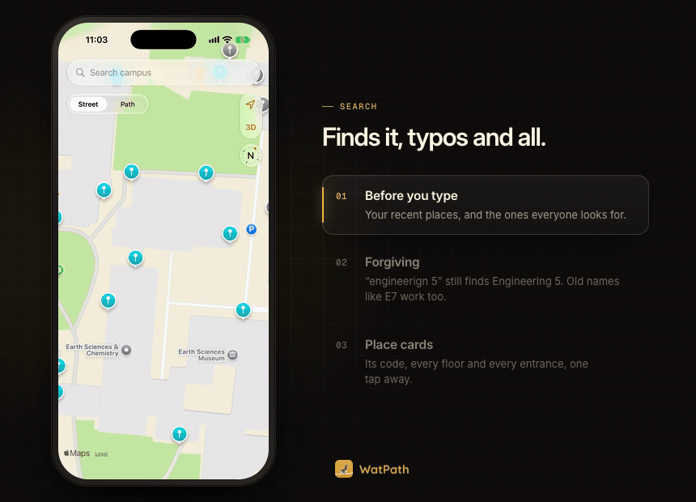
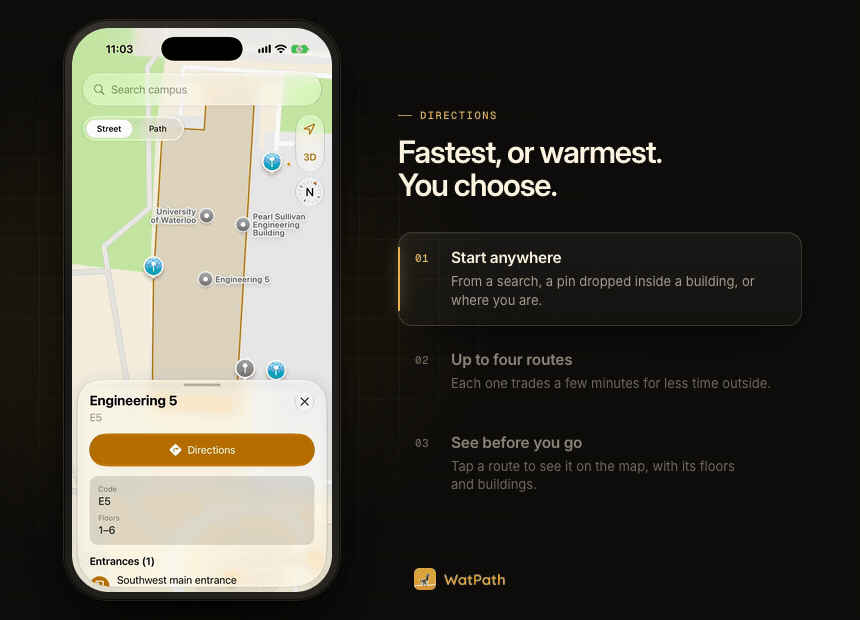
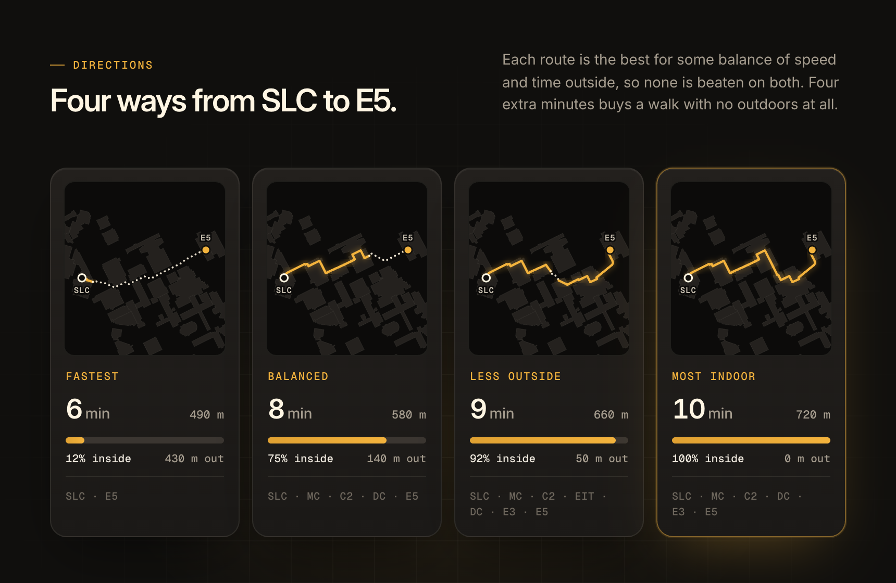
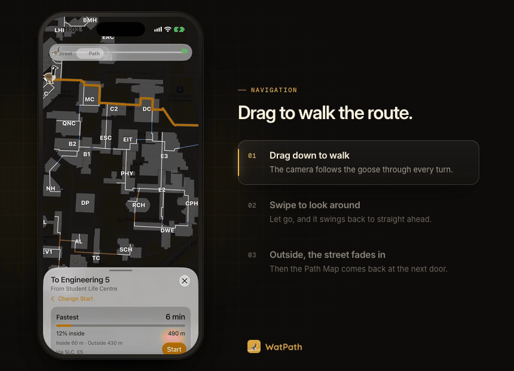
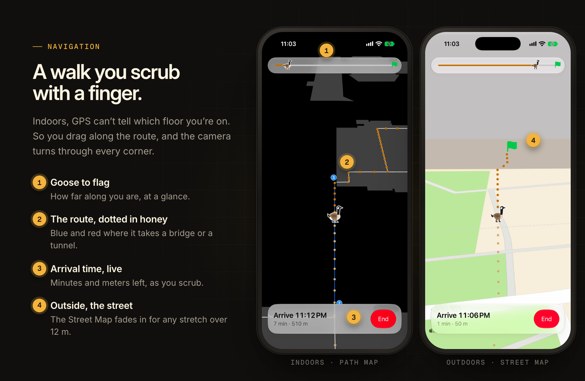
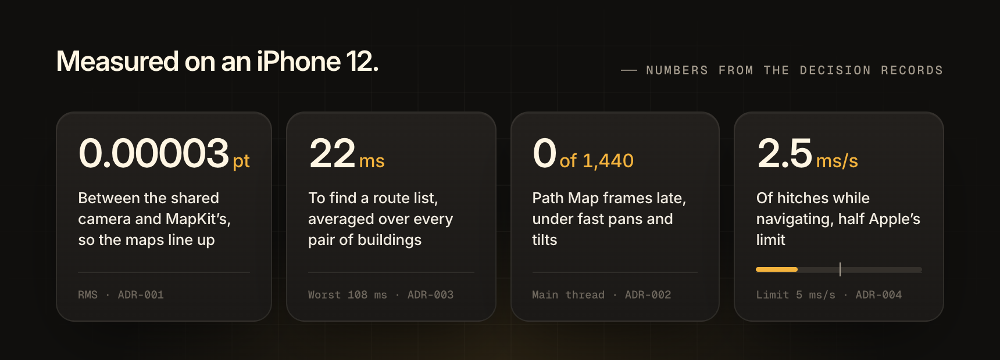

<p align="center">
  
</p>

<p align="center">
  <b>The indoor map of the University of Waterloo, for iPhone.</b><br>
  See the corridors, bridges and tunnels inside 38 campus buildings, choose how much of a route you'd rather spend outside, and walk it before you go.
</p>

<p align="center">
  <a href="https://github.com/yutoc05/watpath/actions/workflows/ci.yml"></a>
  
  
  
  
</p>

<p align="center">
  <a href="docs/media/demo.mp4"></a><br>
  <sub>A one-minute tour, recorded in the Simulator. Click it for the <a href="docs/media/demo.mp4">full-quality video</a>.</sub>
</p>

## Waterloo, in January

Much of the main campus is joined up indoors. The SLC–MC bridge, the tunnel from Arts Lecture Hall to Tatham Centre and the bridge into E5 let you get between a lot of buildings without a coat. But you only learn they're there from someone who already knows, and map apps only know the way outside.

WatPath draws every one of them and routes you through them. The campus map and the router ship inside the app, so the Path Map and directions work with no signal, even in a basement corridor.

## Two maps, one camera

<p align="center">
  
</p>

The **Street Map** is Apple Maps in 2D or 3D, with a marker on every entrance of every building WatPath covers. Tap a door or a building for its card.

The **Path Map** is the same view from the inside: flat building footprints on black, and thin lines for corridors (white), bridges (blue) and tunnels (red), with the floors each bridge and tunnel meets marked at its ends.

The two share one camera, so switching is like x-ray vision: a quarter-second cross-fade, and nothing on screen moves.

## The whole network

<p align="center">
  
</p>

The map is compiled from OpenStreetMap and hand-curated lines. A line is drawn only where its route is mapped, and a corridor never leaves its building: the compiler refuses one that does.

## Search that forgives typos

<p align="center">
  
</p>

Search covers every building and entrance on campus. It ranks by prefix, word and edit distance, so "engineerign 5" still finds Engineering 5, and it knows the names people actually use: "Davis Centre" is DC, "Dana Porter" is DP, and E7 is PSE now. Anywhere off campus comes from Apple Maps. Before you type, it shows your recent places and the popular ones, and you can also drop a pin on either map.

## Directions that let you choose

<p align="center">
  
</p>

Every place card has **Directions**. Start from a search, from where you are, or from a pin dropped inside any building, which slides to the nearest spot you can walk. You get up to four routes, each named for what it trades: Fastest, Balanced, Less outside and Most indoor. Each shows its time, its distance, how much of it is indoors, the buildings it passes through and the floors it climbs. Tap one to see it on the map.

<p align="center">
  
</p>

The router searches by building and floor, so stairs count even though the map is flat. Each route it offers is the best one for some trade between minutes and minutes outside, so no route on the list is beaten on both.

## Walk the route with your thumb

<p align="center">
  
</p>

Start a route and the map flies to its beginning, where a Canada goose waits on a dotted line. Drag down to walk forward and up to go back, and flick to cover ground. The camera turns through every corner by itself. Drag sideways to look around and it swings back when you let go, and pinch to zoom from 90 to 600 m. Where the route goes outside for 12 m or more, the Street Map fades in, and the Path Map comes back at the next door.

<p align="center">
  
</p>

Indoors, GPS is often 10 to 30 m out and can't tell one floor from another, so the walk is yours to drive rather than a blue dot to chase.

## Under the hood

<p align="center">
  
</p>

- **One camera, measured.** MapKit owns the camera in both modes. A model fitted to MapKit's own projection predicts where every point lands on screen with an RMS error of 0.00003 pt on an iPhone 12, so the Path Map sits exactly over the Street Map ([ADR-001](docs/adr/001-camera-architecture.md)).
- **A Path Map that keeps up.** It's one opaque view of Core Animation layers, redrawn from MapKit's camera. MapKit overlays came first and failed on the phone: the street map flashed through on fast pans, and tilted lines dimmed under its 3D buildings ([ADR-002](docs/adr/002-flat-path-map.md)).
- **Routing that knows about floors.** Dijkstra over (node, floor) on one graph of indoor lines and OpenStreetMap footpaths, joined at the doors. A sweep over how much a minute outside is worth finds the routes worth offering ([ADR-003](docs/adr/003-routing.md)).
- **Navigation that lets MapKit rest.** All motion lives in a rig of plain values with its own tests. While the Path Map covers the screen, MapKit is hidden and left alone, and it wakes 60 m before a stretch outside. That turned hitches of up to 383 ms into a few single dropped frames ([ADR-004](docs/adr/004-navigation.md)).

<p align="center">
  
</p>

## Running it yourself

You'll need Xcode 27 (iOS 26 SDK or newer), [XcodeGen](https://github.com/yonaskolb/XcodeGen) (`brew install xcodegen`), and Python 3.12+ with [uv](https://docs.astral.sh/uv/) for the data tools.

```sh
make project       # generate WatPath.xcodeproj from project.yml
make data          # compile data/ into build/CampusBundle
make sim           # build and run in the Simulator
make test          # Python and Swift unit tests
make uitest        # UI flow tests in the Simulator
make demo          # record the tour and cut docs/media/demo.mp4 and demo.gif
make readme-media  # record the feature clips and draw this README's images
```

### On an iPhone, with a free Apple ID

1. Run `make project` and open `WatPath.xcodeproj`.
2. In the WatPath target, go to **Signing & Capabilities** and pick your Personal Team.
3. Copy `Config/Local.xcconfig.example` to `Config/Local.xcconfig` and put your team ID
   in it, so regenerating the project keeps it.
4. Run `make device`. On the first launch, trust the developer certificate on the phone:
   **Settings → General → VPN & Device Management**.

> [!IMPORTANT]
> Free provisioning runs out after 7 days. Run `make device` again to re-sign.

## Repository map

| Path | Contents |
|---|---|
| `App/` | The iOS app: SwiftUI shell, MapKit Street Map, Core Animation Path Map |
| `Packages/WatPathKit/` | Platform-independent modules: `CampusGeo` (map projection, camera model, geometry), `CampusModel` (bundle types), `CampusSearch` (offline search, recents), `Routing` (walking graph, route search, directions flow, navigation) |
| `AppUITests/` | UI flow tests, and the scripted tours behind the demo and the clips above |
| `data/` | Map source data: hand-curated `campus/` and generated `osm/` |
| `tools/` | OSM importer, map compiler, build and run scripts, and `demo/`, which records the tours and makes the video, clips and images |
| `design/` | The app icon, and in `readme/` the pages this README's images are drawn from |
| `docs/` | Plan, decision records, generated coverage report, survey checklist, and `media/` |

## Stack

| Layer | |
|---|---|
| App | Swift 6 with strict concurrency, SwiftUI, MapKit, Core Animation |
| Core logic | A Swift package on Foundation alone, tested with Swift Testing on macOS and Linux |
| Map data | Python, shapely and pytest, run with uv |
| UI tests and media | XCUITest, `simctl`, ffmpeg, headless Chrome |
| CI | GitHub Actions |

## What's next

- [x] Street Map, search and place cards
- [x] Path Map and the x-ray switch
- [x] Floor-aware routing and the route list
- [x] Scrub navigation
- [x] App icon, colors and the demo
- [ ] Check every door and connection on site
- [ ] Haptics and finishing animations
- [ ] Empty, error and permission states, and onboarding
- [ ] An accessibility audit and a performance pass
- [ ] The links through M4, when it opens in 2027

## Further reading

- [docs/PLAN.md](docs/PLAN.md): the plan, the scope and every decision so far
- [ADR-001](docs/adr/001-camera-architecture.md): the shared camera
- [ADR-002](docs/adr/002-flat-path-map.md): how the Path Map is drawn
- [ADR-003](docs/adr/003-routing.md): how routes are found
- [ADR-004](docs/adr/004-navigation.md): how navigation moves
- [docs/coverage.md](docs/coverage.md): what's mapped, building by building
- [docs/survey.md](docs/survey.md): the checklist for checking it on site

## Map data

Building outlines, entrances and footpaths come from [OpenStreetMap](https://www.openstreetmap.org/copyright), © OpenStreetMap contributors, under the ODbL. UW floor plans are never committed (`data/private/` is gitignored).
